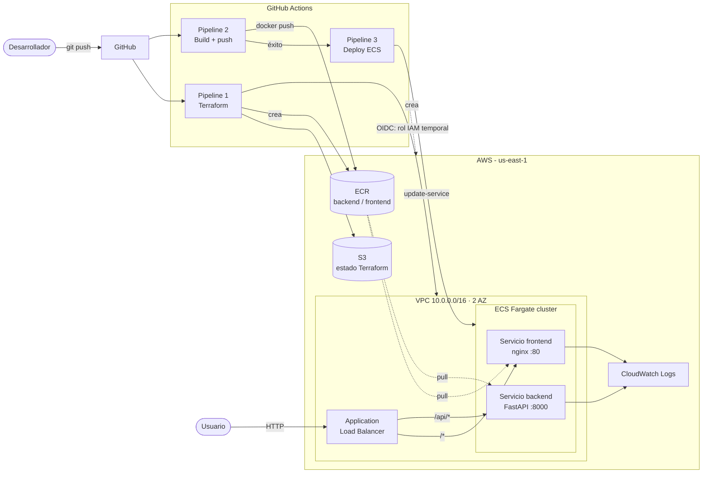

# Proyecto Final: tres pipelines DevOps en AWS

Una aplicación web de tareas (frontend + API) se construye, se publica en **Amazon ECR** y se ejecuta en **Amazon ECS Fargate**. Toda la infraestructura se crea con **Terraform**, y los tres pipelines corren en **GitHub Actions**.

| Componente | Tecnología |
|---|---|
| Infraestructura como código | Terraform ≥ 1.10 (provider AWS 6.x), estado en S3 con bloqueo |
| CI/CD | GitHub Actions + OIDC con AWS (sin llaves de acceso) |
| Backend | Python 3.12 · FastAPI · Uvicorn |
| Frontend | HTML/JS con Vite, servido por nginx |
| Registro de imágenes | Amazon ECR |
| Ejecución | Amazon ECS Fargate detrás de un Application Load Balancer |
| Logs | Amazon CloudWatch Logs |

## Arquitectura



**Comunicación frontend ↔ backend:** el navegador carga el frontend desde el ALB y llama a `/api/...` en el **mismo dominio**. La regla del ALB envía `/api/*` al servicio backend, así que no hace falta CORS ni exponer el backend aparte.

### Decisiones de arquitectura

| Decisión | Por qué |
|---|---|
| **Fargate** en lugar de EC2 | No hay servidores que administrar y se paga solo por las tareas en ejecución. |
| **ALB con reglas por ruta** | Un único punto de entrada para frontend y API, con health checks por servicio. |
| **Subredes públicas sin NAT Gateway** | Un NAT cuesta ~32 USD/mes. Las tareas tienen IP pública solo para salir (descargar de ECR), y su Security Group **solo acepta tráfico desde el ALB**. En producción real se usarían subredes privadas + NAT o VPC endpoints. |
| **Servicios creados con 0 tareas** | Al ejecutar Terraform todavía no hay imágenes. El Pipeline 3 sube el servicio a 1 tarea con la imagen real, y Terraform ignora `task_definition` y `desired_count` para no pisar los despliegues. |
| **Imágenes con el SHA del commit** | Cada versión desplegada es trazable y se puede volver a cualquiera (rollback manual del Pipeline 3). |
| **Circuit breaker + verificación propia** | ECS revierte solo si las tareas nuevas no pasan los health checks, y el script del Pipeline 3 lo detecta y pone el pipeline en rojo. |
| **OIDC en lugar de Access Keys** | GitHub recibe credenciales temporales (1 h) de un rol que solo puede asumir **este repositorio**. No existe ninguna llave que se pueda filtrar. |

## Estructura

```
├── terraform/          Infraestructura (Terraform)
│   ├── bootstrap/      Se ejecuta 1 vez: bucket de estado + OIDC + rol IAM
│   └── *.tf            Red, seguridad, ECR, ALB, ECS, IAM, logs
├── aplicacion/
│   ├── backend/        API FastAPI + pruebas + Dockerfile
│   ├── frontend/       Vite + nginx + Dockerfile (multi-stage)
│   └── docker-compose.yml   Prueba local que imita el ALB
├── pipelines/          Definiciones de los 3 pipelines + scripts
└── .github/workflows/  Copia que ejecuta GitHub Actions
```

## Requisitos

- Cuenta de AWS y un usuario IAM con permisos de administrador **solo para el bootstrap** (en tu PC).
- [Terraform](https://developer.hashicorp.com/terraform/install) ≥ 1.10 y [AWS CLI v2](https://docs.aws.amazon.com/cli/latest/userguide/getting-started-install.html).
- Repositorio en GitHub.
- Opcional, para probar en local: Docker Desktop, Python 3.12 y Node 22.

## Cómo reproducir la solución

### 1. Subir el código a GitHub

```bash
git init && git add . && git commit -m "Proyecto final: tres pipelines"
git branch -M main
git remote add origin https://github.com/<usuario>/<repo>.git
git push -u origin main
```

> Los workflows van a fallar en este primer push porque todavía faltan las variables. Es normal.

### 2. Bootstrap en AWS (una vez, desde tu PC)

```bash
aws configure                     # usuario administrador
cd terraform/bootstrap
cp terraform.tfvars.example terraform.tfvars   # pon github_repo = "<usuario>/<repo>"
terraform init && terraform apply
```

Anota las salidas `tf_state_bucket` y `github_actions_role_arn`.

### 3. Configurar el repositorio en GitHub

**Settings → Secrets and variables → Actions → pestaña *Variables*** (no son secretos, pero tampoco hay ninguno):

| Variable | Valor |
|---|---|
| `AWS_REGION` | `us-east-1` |
| `PROJECT_NAME` | `triple-pipeline` (igual que en el bootstrap) |
| `AWS_ROLE_ARN` | salida `github_actions_role_arn` |
| `TF_STATE_BUCKET` | salida `tf_state_bucket` |

**Settings → Environments:**
- `infraestructura` → activa **Required reviewers** y agrégate. El apply/destroy esperará tu aprobación.
- `produccion` → sin reglas (solo muestra la URL de la app en cada despliegue).

> Si el repositorio es **privado**, las reglas de aprobación requieren GitHub Pro (gratis con el GitHub Student Developer Pack). En un repositorio público funcionan sin costo.

### 4. Ejecutar los pipelines

1. **Actions → "1 - Infraestructura (Terraform)" → Run workflow → `apply`.** Revisa el plan, aprueba y espera unos 5 minutos.
2. **Actions → "2 - Build y publicación en ECR" → Run workflow.** También se dispara solo con cualquier push en `aplicacion/`.
3. **"3 - Despliegue en ECS"** arranca solo cuando el 2 termina bien. Al final muestra la URL de la aplicación.

### 5. Probar en local (opcional)

```bash
cd aplicacion
docker compose up --build     # http://localhost:8080
```

O sin Docker: `uvicorn app.main:app --reload` en `backend/` y `npm install && npm run dev` en `frontend/` (http://localhost:5173).

## Guion para la demo en vivo (~10 min)

1. **Arquitectura:** el diagrama de arriba y la tabla de decisiones.
2. **Pipeline 1:** la ejecución en Actions (fmt/validate/plan, aprobación, apply). Después, en la consola de AWS: VPC, Security Groups, ALB y cluster ECS.
3. **Cambio en vivo:** editar un texto del frontend (por ejemplo, el `<h1>` en `aplicacion/frontend/index.html`) y hacer `git push`.
4. **Pipeline 2:** pruebas, build e imágenes subidas. En **ECR**, mostrar los tags `<sha>` y `latest`.
5. **Pipeline 3:** nueva task definition, servicio estable y smoke test en verde. En ECS, la revisión nueva corriendo.
6. **Aplicación:** abrir la URL, crear y completar tareas. La barra verde muestra la **versión (SHA)** y el **contenedor** que responde. Abrir también `/api/docs`.
7. **Credenciales:** no hay llaves en el repo. Mostrar el rol IAM, su política de confianza (solo este repo) y el paso de OIDC en los logs.
8. **Errores (opcional):** cómo el circuit breaker y el script hacen rollback, y cómo redesplegar una versión anterior con "Run workflow" del Pipeline 3 indicando el SHA.

## Manejo de credenciales

- **Cero secretos en el repositorio:** GitHub obtiene credenciales temporales por OIDC. Las variables del repo (`AWS_ROLE_ARN`, etc.) no son secretas.
- El rol IAM **solo** lo puede asumir este repositorio (condición `sub = repo:<usuario>/<repo>:*`) y solo puede crear o modificar roles con el prefijo del proyecto.
- Las tareas ECS usan un rol de ejecución con la política administrada mínima de AWS.
- `.gitignore` excluye `*.tfvars`, `*.tfstate`, `.env` y llaves.

## Costos y limpieza

Con todo encendido, el gasto es del orden de **1 USD al día** (ALB, 2 tareas Fargate pequeñas, IPs públicas). Revisa los precios actuales en la [calculadora de AWS](https://calculator.aws/). **Después de la demo:**

1. Actions → Pipeline 1 → Run workflow → **`destroy`** → aprobar.
2. En tu PC, para borrar también el bootstrap: vacía el bucket de estado (tiene versionado, así que hay que borrar todas las versiones desde la consola de S3) y luego ejecuta `cd terraform/bootstrap && terraform destroy`.

## Equipo y roles en la demo

| Integrante | Parte que presenta |
|---|---|
| Gonzalo Hooker | Arquitectura y Pipeline 1 (Terraform) |
| María Madrid | Pipeline 2 y Amazon ECR |
| Angel Márquez | Pipeline 3 y la aplicación |
| Eriol Tuñon | Credenciales (OIDC) y manejo de errores |

## Evidencia de la demo

- Formato: presentación en vivo ante el docente (sin video).
- URL usada en la demo: http://triple-pipeline-alb-1857610065.us-east-1.elb.amazonaws.com
  (solo HTTP: escribir `http://` completo; algunos navegadores, como Brave, fuerzan HTTPS y no cargan).
- Ejecuciones en GitHub Actions:
  - [Pipeline 1 — `apply` con aprobación manual](https://github.com/Eriiel/Proyecto-Final-Pipelines-con-AWS/actions/runs/42762640520)
  - [Pipeline 2 — build y publicación en ECR (primer despliegue)](https://github.com/Eriiel/Proyecto-Final-Pipelines-con-AWS/actions/runs/42763349519)
  - [Pipeline 3 — despliegue en ECS (primer despliegue)](https://github.com/Eriiel/Proyecto-Final-Pipelines-con-AWS/actions/runs/42763425797)
  - Cambio en vivo (`push` del subtítulo): [Pipeline 2](https://github.com/Eriiel/Proyecto-Final-Pipelines-con-AWS/actions/runs/42766072099) → [Pipeline 3](https://github.com/Eriiel/Proyecto-Final-Pipelines-con-AWS/actions/runs/42766145283)
  - [Rollback manual al commit anterior (Pipeline 3 con `image_tag`)](https://github.com/Eriiel/Proyecto-Final-Pipelines-con-AWS/actions/runs/42766828213)
- Tiempos medidos en el ensayo:
  - Cambio en vivo, del `git push` a la app actualizada: **6 min 40 s** (Pipeline 2 ≈ 40 s, Pipeline 3 ≈ 6 min, casi todo esperando a que ECS quede estable).
  - Rollback manual: **5 min 39 s**.
- Capturas (en [`docs/evidencia/`](docs/evidencia/)):
  - `01-app-escritorio.png` — la app en el navegador de escritorio
  - `02-app-movil.png` — la app en el celular
  - `03-pipeline-1.png` — Pipeline 1 (Terraform)
  - `04-pipeline-2.png` — Pipeline 2 (build y ECR)
  - `05-pipeline-3.png` — Pipeline 3 (deploy y smoke test)
  - `06-aprobacion.png` — job "Aplicar" del Pipeline 1 tras la aprobación manual del environment `infraestructura`
  - `07-ecr.png` — repositorios en Amazon ECR (ID de cuenta oculto)
